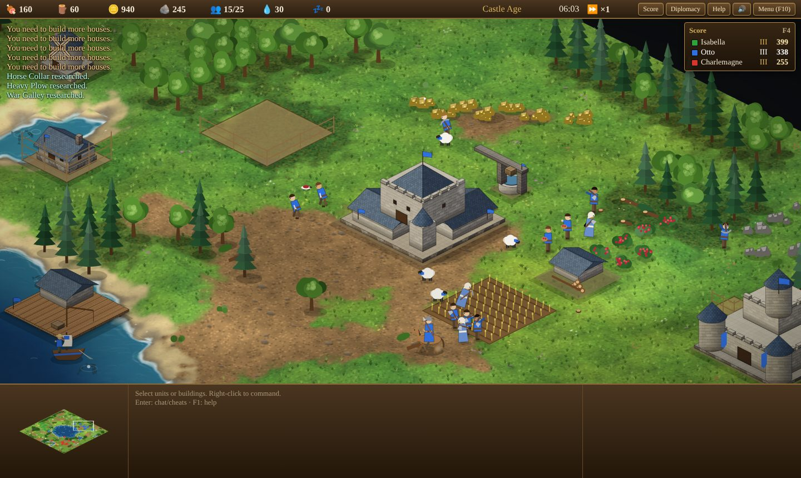
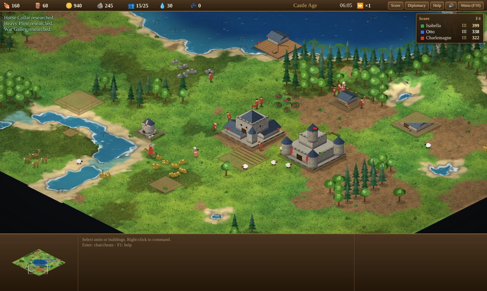
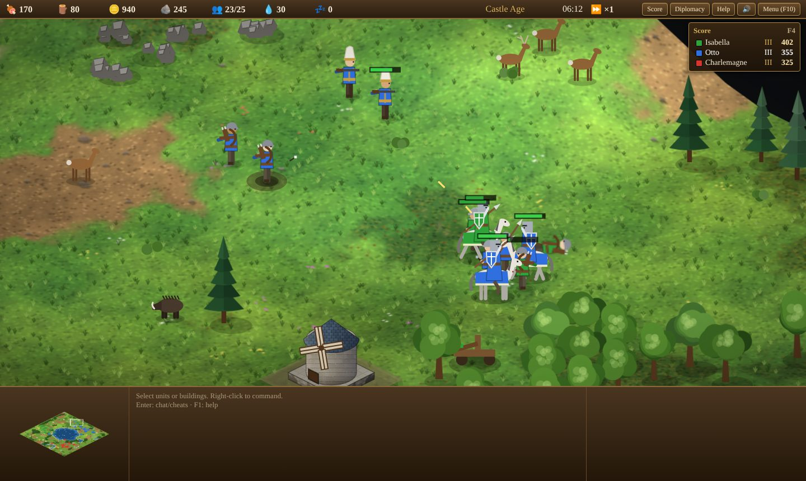
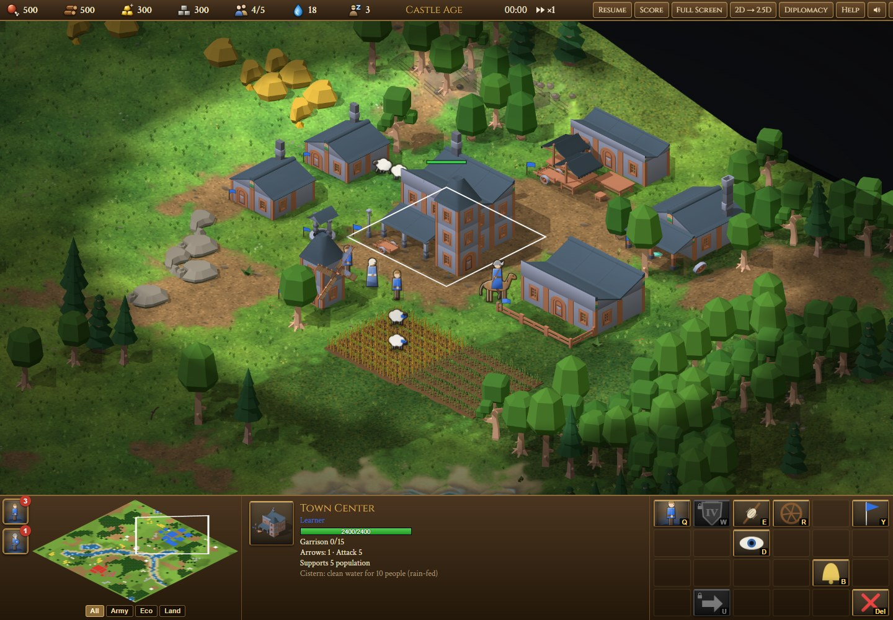

# Age of Realms

A strategy game you play in your web browser: grow a medieval village, advance through six ages into modern and futuristic warfare, build an army and defeat computer rivals. It is free, runs on your own computer and needs no account.

## How to play (no technical knowledge needed)

You need a Windows or Mac computer with a keyboard and mouse, and about 5 minutes the first time.

**1. Download the game**

1. On this page, click the green **Code** button near the top, then **Download ZIP**.
2. Open your Downloads folder and unzip the file:
   - **Windows:** right-click `age-of-realms-mod-main.zip` → **Extract All…** → **Extract**.
   - **Mac:** double-click the zip file.
3. You now have a folder called `age-of-realms-mod-main`. You can move it anywhere, for example to your Documents.

**2. Install Python (once)**

The game uses Python to run a tiny private web server on your computer. Nothing is sent to the internet.

- **Windows:** go to [python.org/downloads](https://www.python.org/downloads/), click the yellow **Download Python** button and run the installer. On the first screen, **tick "Add python.exe to PATH"**, then click **Install Now**.
- **Mac:** usually nothing to do. If the game later says Python is missing, install it from [python.org/downloads](https://www.python.org/downloads/) or accept the "install command line developer tools" offer that macOS shows.

**3. Start the game**

Open the `age-of-realms-mod-main` folder and double-click:

- **Windows:** `Start Game (Windows).bat`. If a blue "Windows protected your PC" box appears, click **More info** → **Run anyway**.
- **Mac:** `Start Game (Mac).command`. The first time, macOS may refuse to open it: right-click (or Control-click) the file, choose **Open**, then **Open** again.

A small black window opens and, after a moment, the game appears in your web browser. If the browser does not open by itself, type `http://127.0.0.1:8000/game/` into its address bar.

**Keep the small black window open while you play.** When you are done, close the browser tab and then that window.

**4. First game**

Click **Learn to Play** for five short interactive lessons, or **Single Player** → **Start Game**. Press **F1** in a game for help. Sound starts after your first click.

**AI-assisted play:** enable **AI Assist — share control of your realm** in Game Setup, or click **AI Assist: Off** in the game toolbar. The computer gathers resources, builds, trains and fights for you. Select units and right-click to give your own commands; these take priority, including Shift-queued orders. The AI resumes after the orders finish. Gathering and other continuous tasks remain yours until you change them or click **Return to AI** in the selection panel. **Stop** and combat stances keep units under your control until you return them to the AI. You can toggle assistance at any time; current orders continue when it is off. Assistance and player overrides are saved with the match. It runs locally without an account or internet connection.

**Getting a newer version:** download the ZIP again (step 1) and use the new folder. Saved matches live in your browser, so they stay available as long as you use the same browser.

**Something wrong?**

| Problem | What to do |
|---|---|
| "Python is needed…" message | Install Python (step 2). On Windows, make sure "Add python.exe to PATH" was ticked; if not, run the installer again, choose **Modify**, and tick it. |
| The window closes at once, or says port 8000 is in use | Another copy is probably still running. Close all of its black windows and try again, or restart the computer. |
| The browser shows "This site can't be reached" | Wait a few seconds and press Refresh. The black window must stay open. |
| A blank page, or nothing happens when you double-click `index.html` | Always start with the **Start Game** file, not by opening `index.html` directly. |

---

## About

A browser real-time strategy game in plain HTML, CSS and JavaScript. You grow a medieval settlement, advance through six ages, build an economy and an army, and defeat computer rivals. Playing requires no build step or external network calls. An optional Three.js renderer is bundled locally; development dependencies support browser tests and updating that bundle.

It starts from the Special Build of Barty-Bart's [Opus 5.5 effort-comparison experiment](https://github.com/Barty-Bart/opus-55-effort-comparison) and adds systems for mortality, water, terraforming and engineering. The six original builds are archived unchanged in [`legacy/`](legacy/).



<p> </p>

## Play from the command line

For people comfortable with a terminal (Linux too):

```sh
git clone https://github.com/sbalci/age-of-realms-mod
cd age-of-realms-mod
python3 -m http.server 8000 --bind 127.0.0.1     # Windows: py -m http.server 8000 --bind 127.0.0.1
```

Open http://127.0.0.1:8000 and press **Play**, or go straight to http://127.0.0.1:8000/game/.

A local server is required. Opening `index.html` directly may not load the scripts. Use a desktop keyboard and mouse. Audio starts after the first click.

Press **Full Screen** in the menu or game HUD to fill the display. Press **Esc** or **Exit Full Screen** to return. The canvas follows the available window size.

**Art styles.** Kenney's medieval artwork is the default: buildings, varied trees, mines, berry bushes, undergrowth, felled timber and wheat fields rendered from the free [Fantasy Town](https://kenney.nl/assets/fantasy-town-kit), [Castle](https://kenney.nl/assets/castle-kit) and [Nature](https://kenney.nl/assets/nature-kit) kits (CC0, public domain). Farms show three harvest stages and berry bushes lose fruit as they are gathered. **Classic Art** in the main menu restores the drawn style; **Kenney Art** switches back. The choice is remembered, or force it with `/game/?art=kenney` or `?art=classic`. Walls and gates retain their connected drawn art. Sprites are bundled locally and load after the game boots; missing images use the drawn fallback.

The source models and original licenses are in `assets/thirdparty/kenney/`. After installing the development dependencies, `npm run art:bake` rebuilds the scenery sprites in `game/art/kenney/` from `tools/art/kenney-recipes.js`. A local Playwright Chromium installation is needed (`npx playwright install chromium`); `CHROMIUM_PATH` can select an existing Chromium executable for baking and browser tests. See [the graphics review](docs/GRAPHICS_REVIEW.md) for scope and validation. Turks and Saracens buildings come from an original CC0 parts kit scripted in Blender (`tools/art/blender/islamic_kit.py`, shared helpers in `kitlib.py`, `npm run art:kit`) and assembled per civilization in `tools/art/turks-recipes.mjs` and `saracens-recipes.mjs`; its GLBs are committed, so baking does not need Blender. The Turks have their own sprite for all 18 building types (not walls, gates, farms or the Wonder) in every age they exist: Seljuk (ages 0–1), Ottoman (2–3), Tanzimat (4) and Republican (5). A civilization's own sprites load the first time it is drawn. Use `npm run art:bake -- --recipes <recipe,...>` to bake specific recipes without re-rendering the rest.

**Animated units and later eras.** The main-menu **Unit artwork** selector offers Seljuk, Ottoman, medieval, modern and futuristic styles. The default follows civilization and age: Turkish units begin with Seljuk dress, then use Ottoman dress; workers change clothing in the new ages. The 53 actor atlases include villagers, warriors, cavalry, six animal types, tanks and walkers, with animation and player colors. They use Kenney/Quaternius CC0 rigs plus original equipment and model recipes. Open [the interactive asset gallery](tools/art/actor-gallery.html) on the local server, see [the full preview](assets/screenshots/unit-library.jpg), or read [sources, licenses and progression rules](docs/ACTOR_ASSETS.md). Rebuild with `npm run art:actors`.

After Imperial, research **Modern Age** at the Town Center to unlock Riflemen, Marksmen and Battle Tanks. Research **Industrialization** and **Electronics** at the University, then **Future Age** at the Town Center to unlock Plasma Guards, Railgunners and Fusion Walkers. Seven supporting technologies improve the economy, weapons and armor. Both new ages are also available as starting ages in Game Setup.



The optional **2.5D prototype** uses Three.js for elevated terrain, procedural building meshes, lighting and shadows. Units, resources and relics retain their existing sprite art, with the same simulation, commands and saves. Click **Try 2.5D Graphics**, or open `/game/?renderer=three`; the HUD button switches back to Canvas 2D. The choice is remembered locally, and `/game/?renderer=canvas` forces the original renderer. WebGL2 is required; initialization failures fall back to Canvas 2D.

This prototype keeps the fixed isometric camera and uses terrain raycasting for commands. Engineering layers are visualized, and terrain edits rebuild the mesh. Projectiles, selection and placement indicators remain canvas overlays; some original cosmetic effects are exclusive to Canvas 2D. Buildings use procedural shapes rather than imported models. Renderer counters are available at `window.__game.T25D.stats`. Three.js and its MIT license live in `game/vendor/three`; after updating the pinned development dependency, run `npm run vendor:three` to refresh those files.

The 2.5D view includes animated water glints that respect fog and building occlusion, gates that visibly open and close, and colored selection and hover outlines. Shoreline faces connect raised land to the water surface without gaps. Wall connections inspect only the four neighboring tiles and respect ownership and map edges. The pathfinding budget keeps usable routes during busy ticks, while changed destinations and terrain edits force a fresh route. Loading a match resets that budget while preserving the saved terrain revision.

## What's in the game

**Base game (Special Build)**
- 10 civilizations with unique units, including the **Turks** (Janissary hand cannoneers; their monks are Imams).
- Four medieval ages and a full economy, extended with Modern and Future ages.
- Navy and transports, monks and relics, trade and the market.
- Diplomacy and tribute.
- Elevation and cliffs.
- Garrisoning and the town bell.
- Wildlife and weather.
- Procedural music and unit speech.
- Four AI difficulty levels.
- A map editor, save and load of maps, and cheats (Enter; e.g. `marco`, `polo`, and `ibn battuta` to reveal the map and lift the fog at once).

**Mortality and veterans** (`game/js/mod.js`)
- People age:
  - soldiers live about 20 minutes, villagers about 30 and monks about 35, each with ±15% variation;
  - machines, ships and animals don't age;
  - deaths from old age don't count as battle losses.
- One in ten villagers takes vows on becoming elderly (85% of their lifespan, about 25½ minutes), becoming a Monk or a Turkish Imam.
- Villagers in the last 15% of their lives are elders and gather 15% slower.
- Soldiers who survive a battle earn experience and are promoted to Veteran, Elite and Champion. Each rank adds attack, hit points and armor, shown as chevrons above the unit.

**Real-world maps, Wonders and mining** ([guide](docs/MAPS_AND_MINES.md))
- Anatolia, Mediterranean and World presets use bundled public-domain Natural Earth coastlines and lakes.
- Wonders can be started in any age and evolve through six architectural forms; their victory countdown survives advancement.
- Coal is required for Modern Age, Industrialization, Precision Rifling and Composite Armor.
- Right-click a buried seam with villagers to excavate and mine it, or open a connected sapper tunnel beneath a mountain.

**Waters** (`game/js/water.js`)
- Rivers with fords, plus lakes and seas, are classified per tile.
- Rivers and lakes are fresh water; the sea is salt.
- Fish regrow, but a shoal fished below 20% never recovers.

**Clean water and wells** (`game/js/wells.js`)
- Water capacity comes from Town Center cisterns and Wells (hotkey C). Both serve more people near fresh water.
- Above capacity, gathering slows and people wear down, but thirst never kills.

**Water and ageing economy** (`game/js/balance.js`)
- Herbal Medicine (Monastery, Feudal): everyone lives 20% longer.
- Sanitation (University, Feudal): Wells and Town Centers serve 50% more people.
- The AI trains a replacement about two minutes before a villager retires or takes vows, and researches both technologies.

**Terrain and battle tactics** (`game/js/tactics.js`)
- Forest cover: ranged attacks do 25% less to units in forest.
- Fords: fighting from a ford does 20% less; units caught in a ford take 15% more from melee.
- Flanking: hitting a busy unit from behind does 20% more.
- Leadership: soldiers near an Elite or Champion of their own side do 10% more.
- The AI keeps a battle memory and trains counters to what hurts it, stages waves on high ground before attacking, regroups broken waves, heals wounded veterans in garrisons and moves archers uphill.
- The 💧 in the top bar shows capacity. The AI digs wells ahead of its needs.

**Terraforming and engineering** (`game/js/terra.js`): select villagers and press **N**.
- **Canals:** ships can sail them.
- **Trenches:** units inside move slower and take less pierce damage; cavalry, siege and carts cannot cross.
- **Raise, lower and excavate:** raising costs stone; removing elevation refunds stone. Digging mine shafts opens buried deposits without generating stone.
- **Plant trees:** saplings mature into trees.
- **Bridges** (15 wood per tile): land units cross and ships sail under. Removing a bridge refunds 8 wood.
- **Sappers** (Mining Camp, Feudal Age):
  - dig tunnels through hills and mountains, 5 stone per tile, up to 12 tiles;
  - units in a tunnel are hidden from enemies;
  - sappers dig 60% faster than villagers.

**Commands and battle** (`game/js/command.js`)
- **Orders and formations:**
  - Shift-queued orders with waypoints.
  - Formations that face the march: melee in front, ranged behind, siege and monks at the rear.
  - Combat stances: Aggressive, Defensive, Stand Ground, No Attack.
- **Combat:**
  - Ranged accuracy, so arrows can miss.
  - Soldiers blocked by walls breach the nearest wall or gate.
  - Units trapped by terrain changes are rescued.
  - Villagers and monks flee from melee attackers.
  - Scouts no longer kill sheep.
  - No friendly fire: catapult splash spares your own and allied units, and soldiers earn experience only from fighting enemies.
- **Movement** (`game/js/movement.js`): units slide around corners, respect cliff edges in crowds, sidestep oncoming units and recover when wedged. In AI test games this cut units stuck for 5 s or more from about 50 to about 3 per 8 minutes (`?move=off` restores the old movement).
- **Keys and controls:**
  - `,` cycles idle soldiers.
  - Home jumps to the last attack.
  - `+`/`−` change game speed.
  - `M` toggles music.
  - A Resign button; beaten computer players resign too.

**Victory, technology and score** (`game/js/victory.js`)
- **Wonder** (available in every Age, with evolving architecture) and **relic victory**: hold out for 5 minutes. Announcements and a countdown banner keep everyone informed.
- **Imperial upgrades:**
  - Units: Halberdier, Paladin, Heavy Cavalry Archer, Capped Ram, Onager.
  - Technologies: Crop Rotation, Two-Man Saw, Gold and Stone Shaft Mining, and the full Blacksmith line.
- **Fog-of-war memory:** buildings you saw earlier stay on the map as you last saw them.
- **Scores:** a live score panel (F4) and a tabbed end screen with statistics and a score-over-time chart.

**Watch AI vs AI** (`game/js/extras.js`)
- Tick *Watch AI vs AI* in Game Setup.
- Every player is computer-controlled and the map is revealed.
- Keys 1–8 follow a player, `+`/`−` change speed up to 8×, and F4 shows scores.

**Look** (`game/js/terrain.js`, `game/js/fx.js`)
- **Terrain and buildings:**
  - HD blended terrain: soft transitions, sunlit hills, rocky cliffs, depth-shaded water with surf and wet sand.
  - Building materials change with the age: logs and thatch, then timber frame and clay tile, then stone and slate.
- **Walls, shadows and sky:**
  - Walls and palisades connect into continuous lines.
  - Buildings cast projected shadows.
  - Fog of war fades in and out smoothly.
  - Cloud shadows drift across the map, and the screen edges have a vignette.
- **Effects and battlefield marks:**
  - Soft smoke and glowing fire, with more fire as a building takes damage.
  - Missed arrows stay stuck in the ground, catapult stones leave craters, and corpses stay on the field for a while.
  - Birds circle overhead.
  - A dashed line leads to a waving rally flag.
  - Positional sounds are panned left and right.
- **Sharper units** (`game/js/units_hd.js`):
  - Cached 2× sprites with outlines, shading and a rim light.
  - Smooth motion between simulation ticks.
  - Back views when units walk away.
  - Team-coloured silhouettes for units hidden behind buildings and trees.
  - Drawn SVG resource icons and framed unit portraits.

**Idle buttons:** on the minimap corner, one for idle villagers and one for idle soldiers, each with a count. Click selects the next one; shift-click selects all.

**Command grid and minimap** (`game/js/hud.js`)
- Every command button sits where its hotkey is on the keyboard (Q W E R T Y / A S D F G H / Z X C V B N). Back is always bottom left and Delete bottom right, so positions never shift between selections.
- The minimap is larger, scales with the window, and keeps the map's diamond shape without wasted space.
- Filters under the minimap: All, Army, Eco and Land. Selected units' destinations show as lines; minimap clicks and right-click orders leave a short ring.

The in-game **Help** (F1) describes every system.

### Learning, rules and saving

- **Learn to Play** starts five interactive lessons: selection, gathering, houses, villager training and advancing an age. A peaceful practice opponent gives you time to learn.
- Game Setup exposes individual rules and **Age of Realms**, **Beginner**, and **Classic economy** presets. Beginner removes aging and water pressure; Classic disables the added economy and engineering systems. Rules apply equally to human and computer players. URL switches supply the initial defaults; the setup controls can override them.
- **Controls** lets you remap pause, menu, help, idle-unit, last-attack and music shortcuts. Visible unit command keys take precedence. Groups, camera arrows and chat keys remain reserved.
- **Game Menu → Save Match** stores a manual save. **Export Match** downloads a portable JSON file. **Load Match** is available from the main menu and game menu, with separate manual and autosave slots.
- Autosaves run every 60 **game seconds**, including spectator matches. The save retains resources, units, technologies, orders, shared engineering jobs, AI state, RNG position, fog memory, victory timers and tutorial progress. Cosmetic particles are regenerated. Local saves belong to the browser and site address; use Export Match to move them elsewhere. If storage is full or unavailable, the game reports it and keeps the match running.
- Combat, movement and victory settings are saved too. Advanced URL switches that remove Wonder buildings or Imperial technologies must match the original match when loading; incompatible saves are rejected without replacing the current world.
- Matches pause when the browser loses focus or is hidden. Held camera keys are cleared so scrolling cannot get stuck. Modal dialogs keep keyboard focus inside them.
- Maps use a versioned format that retains bridge, tunnel and trench layers. Old maps without a version still load. Imports are validated before replacing the editor world; supported dimensions are 16–256 tiles per side.

Computer players plan short bridges to reach disconnected enemy territory, train sappers for useful cliff tunnels, and place small defensive trenches during ranged raids. Decisions have a cooldown and reserve resources for the economy.

### URL switches

Add these to the game address, e.g. `game/?aging=off&thirst=off`:

| Switch | Effect |
|---|---|
| `?aging=off` | no lifespans |
| `?veterans=off` | no ranks |
| `?life=0.5` | multiply all lifespans |
| `?rivers=off` | no generated rivers |
| `?fishregen=off` | fish do not regrow |
| `?thirst=off` | no water capacity |
| `?balance=off` | earlier lifespans, no Herbal Medicine or Sanitation, no elder slowdown |
| `?tactics=off` | no forest, ford, flanking or leadership modifiers; classic AI attacks |
| `?hud=off` | flowing command card and the small square minimap |
| `?terra=off` | no terraforming |
| `?hd=off` | classic flat terrain and buildings |
| `?unitshd=off` | classic live-drawn units and emoji icons (finer: `unitsprites`, `unitsmooth`, `facings`, `unitsil`, `hdicons`) |
| `?fx=off` | no visual effects (or one at a time: `walls`, `shadows`, `fogfade`, `clouds`, `vignette`, `particles`, `decals`, `birds`, `rally`, `flash`, `glints`, `pan`) |
| `?queue=off` `?formation=off` `?accuracy=off` `?rescue=off` `?breach=off` `?stances=off` `?flee=off` `?hotkeys=off` `?resign=off` | command features |
| `?wonder=off` `?relicwin=off` `?imperial=off` `?fogmem=off` `?score=off` `?aiwonder=off` | victory/tech features; `?wondertime=N`, `?relictime=N` set the countdowns |

## Repository layout

```
Start Game (Windows).bat / Start Game (Mac).command   double-click launchers
index.html        landing page
game/             the game (all development happens here)
  vendor/fonts/   Cinzel and Crimson Text (SIL OFL), bundled so the game needs no network
  index.html      loads the scripts in order
  style.css
  js/data.js      units, buildings, techs, civs, help text
  js/map.js       map, elevation, regions, pathfinding, map generation
  js/world.js     simulation: units, combat, economy, orders
  js/render.js    isometric canvas renderer (chunk-cached terrain, vector art)
  js/audio.js     procedural sound, music and speech
  js/ai.js        computer players
  js/ui.js        HUD, input, menus
  js/editor.js    map editor
  js/mod.js       mortality, monks, veterans
  js/water.js     water types, rivers, fish
  js/wells.js     wells and clean water
  js/terra.js     terraforming, bridges, sappers, tunnels
  js/command.js   queued orders, formations, stances, accuracy, breaching, hotkeys, resign
  js/victory.js   wonders, relic victory, Imperial upgrades, fog memory, score and statistics
  js/terrain.js   HD terrain texture and building materials
  js/fx.js        walls, shadows, fog fade, clouds, particles, decals, birds, rally flag
  js/extras.js    Turks, peaceful scouts, AI-vs-AI spectating, Ibn Battuta cheat, idle buttons
  js/units_hd.js  cached HD unit sprites, smooth motion, back views, silhouettes, drawn icons
  js/movement.js  corner sliding, cliff-safe separation, sidestepping, unstick
  js/polish.js    path-finding budget, spectator HUD, pause button, gatherer counts, editor help
  js/balance.js   lifespans, elders, Herbal Medicine, Sanitation, AI villager replacement
  js/tactics.js   forest cover, fords, flanking, leadership, AI battle memory and staging
  js/hud.js       fixed command grid, larger minimap, filters and order lines
  js/glyphs.js    drawn UI glyphs that replace emoji
  js/session.js   versioned saves, autosaves and restore
  js/onboarding.js rule presets, remappable shortcuts and interactive lessons
  js/engineering.js bounded AI bridge, tunnel and trench planning
  js/main.js      boot and game loop
tests/            headless tests (Node, no dependencies), balance harness, save fixtures
docs/             improvement plan and balance reports
legacy/           the six original experiment builds, prompts and metrics (archived, not maintained)
```

## Development

- All scripts are classic scripts that share globals. They load in the order given in `game/index.html`.
- Existing mods wrap engine functions. New systems should prefer `GameHooks.on(name, callback)`, which returns an unsubscribe function. The events are `entityAdded`, `worldCreated`, `worldRestored`, `beforeTick`, `afterTick`, `commands` (the command card before it is drawn), `topbar` and `minimap` (drawing on the minimap in tile coordinates). `GameHooks.modify(name, fn)` and `GameHooks.apply(name, value, ...args)` chain value modifiers; `damage` uses them. Water, wells, terrain jobs, victory tracking and unit interpolation now use these hooks. `entityAdded` runs before final unit/building stats are assigned; `worldCreated` runs after base initialization. UI preparation follows `worldRestored`.
- Gameplay randomness uses `simRandom()` / `W.rng`, with its state retained in saves. Cosmetic animation, audio and particles use a separate `Math.random()` stream. A seed and the same orders reproduce the simulation.
- Run `node tests/run-all.js --quick` for focused checks, `node tests/run-all.js --full` for integration and long AI simulations, or a single suite such as `node tests/terraform.test.js`. Headless tests have no dependencies; the new harness reads the real HTML script order. The runner reports process errors, timeouts and failing output.
- For browser tests: `npm ci`, `npx playwright install chromium`, then `npm run test:browser`. Playwright is development-only. The test server binds to localhost; tests cover setup, lessons, save/load, imports and keyboard focus. GitHub Actions runs headless and browser checks on pushes and pull requests.
- Balance report: `node tests/balance-report.js --seeds=1,2,3,4,5,6,7,8,9,10 --minutes=35` plays seeded AI-vs-AI games in parallel and writes `docs/balance/latest.md`, `latest.json`, and one row per run in `docs/balance/history.csv` (age-up times, villager curves, old-age deaths, thirst, winners, slowest tick, and the phase-1 gate: AI in the Castle Age by minute 22). Options: `--maps`, `--civs`, `--difficulty`, `--jobs`, `--timeout`, `--no-history`.
- Performance budget: `node tests/perf.test.js` (part of `--full` and CI) times simulation ticks for an AI economy, a 120-vs-120 battle and an 8-player map, in units of a fixed CPU workload so the budget holds on any machine.
- Save compatibility: `tests/save-compat.test.js` loads every save in `tests/fixtures/saves`, plays it on and saves it again. When a release changes saved state, add a fixture with `node tests/make-save-fixture.js <date>-<commit>-<label>` and never regenerate old ones.
- Quick AI matchups: `node tests/tournament.js --minutes=20 --seeds=1,7 --maps=land,coastal,islands --civs=franks,turks --out=results.json`. Each pairing swaps starting positions. JSON records completion, winner, economy, age, population, losses and inactivity. Short timed-out matches are smoke checks, not evidence of balance.
- `window.__game.PERF` exposes simulation/render milliseconds, effective speed, backlog and dropped time. The loop retains unfinished ticks, budgets up to 32 ticks per frame, caps extreme backlogs at 2 seconds, and shows “catching up” beside game speed when overloaded. Post-victory time advances independently of rendering FPS.
- There is a single branch: `main`.

## Credits

The base game is the Special Build from [Barty-Bart/opus-55-effort-comparison](https://github.com/Barty-Bart/opus-55-effort-comparison), generated by Claude Opus 5.5. This is an independent project and is not affiliated with the makers of Age of Empires II.
